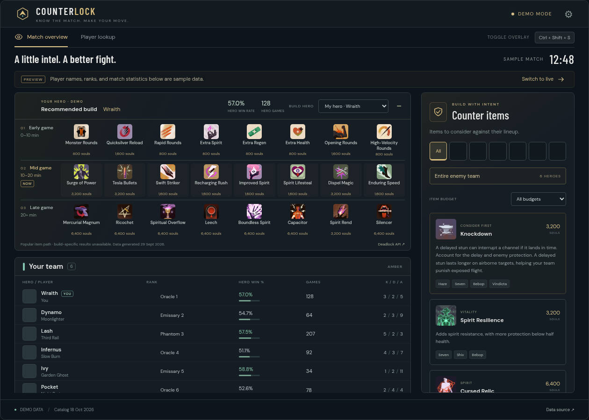

# Counterlock

An Overwolf Native app for team rosters, player ranks, hero win rates and games played, with recommended hero builds and counter-item suggestions. A desktop window adds companion pages: a search-first Home, a Live page, a hero tier list, hero pages with matchups, an item browser, and player profiles with match history. Built with React, TypeScript and Vite, in a "Deadlock noir" look (see [The look](#the-look)).

This is a working development prototype. The browser UI, API handling and simulated Overwolf integration are tested. **A real Windows/Overwolf/Deadlock session has not been tested in this Linux workspace.**



## Try the browser preview

Requires Node.js 22.22+ (the Overwolf app alone needs 22.12+, but the website's React Router 8.5 needs 22.22+, and `package.json` enforces it with `engines`).

```sh
npm ci
npm run dev
```

Open the local URL Vite prints. The browser opens on **Home** with tabs for **Home · Live · Tier list · Heroes · Items**, plus a **My profile** button in the header once an account is remembered. Without Overwolf, **Live** shows "Deadlock isn't running"; with Overwolf it shows "Waiting for a match" until live data arrives. Demo match data is confined to test fixtures. In the browser, Home has no game events to detect your account, so you search for it: **Find a player** accepts a Steam name, an exact SteamID64, account ID, `[U:1:account]` ID or profile link, and the profile's **This is me** button remembers it. **Home**, **Tier list**, **Heroes**, **Items** and profiles make real requests. No API key is required by the endpoints used here.

The root preview redirects to `/desktop/desktop.html`. Open `/in_game/in_game.html` to preview the in-game entrypoint. Without Overwolf, the in-game entrypoint also renders the full browser preview. In Overwolf, it resolves the native window name and mounts one of the five performance panels.

## Load in Overwolf on Windows

1. Obtain an [Overwolf developer-whitelisted account](https://dev.overwolf.com/ow-native/getting-started/onboarding-resources/setting-up-dev-environment/), install Overwolf, and log in. Overwolf currently requires whitelisting for unpacked/unreleased apps.
2. Run `npm run build`, then copy the entire `dist/` folder to the Windows PC. Set `VITE_SITE_URL` to the website's address for the build (for example `VITE_SITE_URL=https://counterlock.gg npm run build`): the match report's **Copy link** copies links to it, and the build warns when it is missing.
3. In Overwolf, open **Settings → About → Development options → Load unpacked extension**. Select the folder containing `manifest.json`, not the project root.
4. Launch Deadlock and enable its Overwolf overlay. The app targets Overwolf game ID **24482** and starts automatically with the game.
5. While Deadlock runs, open the gear button and enable the overlay panels you want. Each starts off until enabled. **Ctrl+Shift+S** shows or hides all enabled panels together; the binding can be changed in Overwolf. Drag each panel's header to move it independently; positions persist. The opacity slider changes panel backgrounds while text stays opaque.

The remembered account comes from Deadlock game events: the `background` window stores the last account it detects on this PC in `localStorage` under `counterlock.profile.account`, and Home's **You** section and the header's **My profile** button use it. If none has been detected, search for yourself on Home, open the profile and press **This is me**; it is stored the same way, and the next account detected in-game replaces it. **Not you? Switch account** clears the stored account. It never leaves this PC except as a public ID in API requests.

The `background` window owns the shared live store, game-event subscriptions, feature registration, hotkeys, and overlay lifecycle. The `desktop` window stays independent of overlay visibility. The five windows (`hero_damage`, `objective_damage`, `healing`, `you_vs_average`, `spawn_timers`) share `in_game/in_game.html`, resolving their native identity at mount time to render the right panel. Each declared HTML path remains stable in `dist/` and in the manifest. Foreground windows subscribe to the background store through `getMainWindow()`; they do not create their own live stores.

For developer packaging and installation, see [Overwolf's unpacked app instructions](https://dev.overwolf.com/ow-native/getting-started/onboarding-resources/basic-sample-app/) and [OPK packaging reference](https://dev.overwolf.com/ow-native/reference/ow-sdk-introduction/).

For Overwolf development, load the built files. Avoid `debug_url` with this background-store bridge: Overwolf documents that `getMainWindow()` behaves differently in that mode.

## What it does

**Companion pages** (desktop window):

- **Live** shows the current match roster, builds and counters, or a "Deadlock isn't running" / "Waiting for a match" state. The app opens on Live when Deadlock is detected running (unless you have already picked a tab); otherwise it opens on Home. It also switches to Live once per match when live data first arrives.
- **Home** is a search (**Find a player**) followed by a **You** section for the remembered account (rank, recent form and latest match, each number explained) and **Top of the city**, the strongest heroes right now.
- **Profile** is its own page, opened from search, **You** or the header's **My profile**: rank badge, ranked games, KDA, souls per minute, top heroes, frequent teammates and a filterable match history, in the tabs Overview, Matches, Performance, Heroes and Live. Click a match for its match report. **Performance** follows the last 20, 50 or 100 normal and ranked games, for all heroes or one, against the average player on the same hero at the same rank; pick a game on a chart to see it and open its match report. Coming back from a match report, or with the browser's Back, finds the profile as it was left: its tab, filters and, on the website, scroll position. Opened any other way, it starts at Overview. **Live** shows the player's match while it is being played, when the game's Watch list has it; for your own account the desktop app shows your match from Overwolf instead. See [Profile Live tab](#profile-live-tab). **This is me** remembers the account; **Not you? Switch account** forgets it.
- **Match report** opens from any match row, from Home's latest match or from a shared link, for any player. **Viewing as** picks whose point of view it takes (any of the 12 players, or the whole match); it opens as you if you played, otherwise as the player you came from. It shows win or loss, verdicts (souls / min, hero damage and creep kills against the average player on that hero at that rank), **the Graph** (nine stat tabs plus "More stats…", player against the rank average, team totals, team lead or everyone, per minute, time ranges, death, item and objective markers, hover and a ranking that switches the point of view), best and worst stretches, impact, permanent buffs and a scoreboard for both teams. **Copy link** copies the website address of the report. See [Match report](#match-report).
- **Tier list** ranks heroes S to D by win-rate percentile over the last 30 days across all ranks, with a role filter.
- **Heroes** is the full roster with search and a role filter. A hero page (with a rank filter) shows abilities (hover, focus or tap one for its tooltip), then two tabs: **Build**, the main build (the most-bought items in each phase: Early 0–10 min, Mid 10–20 min and Late 20+ min, up to eight each), and **Popular builds**, the hero's most-favourited community builds, shown exactly as their authors set them up. **Counter items** come next: pick up to six enemy heroes to see the items, not already in the main build, that gain the most win rate against them (during a match, the desktop app uses the live enemy team instead on the pages of heroes on your team). Then come skill order, matchups, best partners, best items and **Items that beat {Hero}**, which compares an item's win rate against this hero with its overall win rate, adjusted for the hero's overall win rate. Both counter lists fall back to hero-trait heuristics, labelled "Based on hero traits", when the data is too thin. See [Hero page builds and counter items](#hero-page-builds-and-counter-items).
- **Items** ("The Shop") is a shop-style browser with search, filtering and sorting, in columns by category and cost. An item page shows its stats, win and pick rate, and what it builds from and into.

**Live match overlays and roster:**

- The Live tab's build panel (**Your build**) shows the same main build as the hero page, so the two never disagree. The hero selector follows your hero by default; owned items are marked, the current phase is tagged **Now**, and the panel can be collapsed. Build statistics are unavailable in Street Brawl.
- Uses the full in-game shop artwork for both builds and counter cards. All **173 item icons** are bundled locally, so item artwork works without the asset CDN.
- Identifies your team using the local roster entry; enemy detection waits until that identity is available. Team sizes are dynamic, including Street Brawl.
- Shows the latest recorded rank, **hero-specific** win rate and recorded games, plus live K/D/A. The API's hero history is filtered to the active game mode and ranked/unranked matches.
- Keeps missing IDs, unavailable stats, protected profiles and zero recorded games distinct. It never matches players by nickname or fills live gaps with demo data.
- Uses batched hero-stat and rank requests, a five-minute memory cache, timeouts and `Retry-After` cooldowns. Hero statistics can succeed while rank fails, and vice versa. Refresh respects the cache; it is not a cache-bypass button.
- Suggests counter items for a selected enemy or the whole opposing team. Profiles cover all **43 active heroes** in the catalog fetched on **2026-10-18**. Suggestions include reasons and affected heroes, respect an item-price budget, deduplicate items, and exclude your reported inventory.
- Offers manual threat adjustments for unusual enemy builds. Suggestions use hero profiles and those adjustments; enemy inventory does **not** automatically infer a build.

Rank comes from the latest recorded ranked match, not a live rank feed or a historical MMR estimate. API coverage can be incomplete; no row returned does not prove the player has never played that hero. Protected profiles are left unavailable. Overwolf may supply blank Steam IDs, and numeric SteamID64 values already rounded by an upstream parser cannot be recovered. Stringified numeric Steam IDs are preserved before parsing.

The Live counter engine, which is also the hero page's fallback, is a transparent set of strategic heuristics, not a learned optimal build or a statistical claim that an item causes more wins. It does not calculate your build's damage, automatically buy items, or modify Deadlock's files. The budget is a **per-item price limit**, not a shopping-list total or your remaining souls.

The five performance overlays are **Hero damage**, **Objective damage**, **Healing**, **You vs. average**, and **Spawn timers**. Meters sort every listed player by their GEP total, with portraits, team colors and your own gold highlight; missing measurements show “—”. Each panel has its own enable switch and saved position; its × button disables only that panel. The desktop's builds and counters keep working independently of these switches.

**You vs. average** compares separate kills, deaths and assists with the same hero's rank-average curve at the current match time (interpolated between recorded minutes). It uses the local player's latest recorded rank from the shared lookup, or explicitly all ranks when unavailable, and widens thin bands as the match report does. Level and kill participation show live values with “Average unavailable”: the curve has neither a level average nor the team totals needed for a participation average. Participation needs the complete team's known kill counts and a positive total; an unknown denominator shows “—”. **Souls / min remains unavailable** until a real Windows session confirms that GEP `souls` means total net worth. No comparison is invented from unspent currency. A failed benchmark keeps live counts and offers Retry. Street Brawl shows live counts without normal-mode averages or timers.

**Spawn timers** currently shows the Soul Urn's confirmed schedule: first at 10:00, then every five minutes ([Valve's 2026-06-30 update](https://store.steampowered.com/news/app/1422450/view/688635449342692003), checked 2026-10-24). It counts down from GEP's match clock, so pausing or missing clock updates cannot make a wall-clock timer drift. A scheduled spawn is not evidence that the Urn is still available. No exact Unstable Rift timer is shown because its start varies; no Mid Boss or camp respawn is inferred. Native telemetry cadence, souls semantics, pause recovery, multi-monitor movement and input release still need Windows/Overwolf testing.

Home and the hero and item pages use Deadlock API aggregates, so figures reflect community data for the filters shown, not a complete record. Hero tiers are relative to the current win-rate distribution, not an official ranking. A hero page makes ten analytics requests, plus one for each picked enemy. The Deadlock API allows 200 analytics requests per minute per IP; the client holds requests back rather than go over it, so very rapid browsing slows down instead of hitting the cooldown. Picking an enemy again reuses its cached request.

### Hero page builds and counter items

Each list says how it is derived in one line on the page. Item stats cover the last 30 days, with the page's rank filter.

- **Main build:** `GET /v1/analytics/item-stats?hero_id=…&min_bought_at_s=…&max_bought_at_s=…`, one request per phase (0–600 s, 600–1200 s and 1200 s onwards). Each phase lists up to eight of its most-bought items, ordered by average buy time. An item must be bought in at least 5% as many matches as the phase's top item, so a phase can list fewer than eight, and it then says why. An upgrade is kept over its components, and an item listed in an earlier phase, or a component of one, is not listed again. The Live tab's build panel uses the same code.
- **Popular builds:** `GET /v1/builds?hero_id=…&only_latest=true&sort_by=favorites&sort_direction=desc&min_unix_timestamp=…&limit=5`, the five most-favourited builds updated in the last 60 days. Only English builds are shown; when the hero has none, builds in every language are shown instead and the note says so. When no build has a favourite count (new heroes), the builds are reloaded with `sort_by=updated_at` and the note says they are recent rather than popular. Categories, items, duplicates and author notes are shown in the author's order; unnamed categories are called "Items". Author names come from one batched `GET /v1/players/steam` and are left out if that fails.
- **Counter items:** for each picked enemy, `GET /v1/analytics/item-stats?hero_id=…&enemy_hero_ids=…` is compared with all of the hero's games (`item-stats?hero_id=…`, the request **Best items** also uses), net of the matchup's own shift. Items need 200 games against an enemy to count, are ranked by a lower confidence bound of their average win-rate lift (lift minus three standard errors), and are shown only when that bound is above zero. Main-build items are left out. A card shows the lift and the largest single-enemy sample, for example "+5.0% vs these heroes · 3,000+ games", and names the enemies it clearly does better against. After those come items that clear the same bound against one picked enemy but not on average, as long as their average lift is still above zero; their cards show the lift and sample against that enemy, for example "+3.0% vs Seven · 3,661 games". When no item clears either bound, or the data fails to load, the rules-based suggestions are shown instead, labelled "Based on hero traits".

### Match report

Everything comes from `GET /v1/matches/{id}/metadata`: per-player stat snapshots (every 3 min until 15:00, then every 5 min, plus one at the end; lines connect them), deaths, purchases, permanent buff pickups, objectives and Mid Boss. Player names come from one batched `GET /v1/players/steam`. Teams are named Amber and Sapphire.

- **Rank average:** `GET /v1/analytics/player-performance-curve?hero_ids=…&min_average_badge=…&max_average_badge=…&resolution=0` (absolute game time) for the selected player's hero and the whole tier of their rank at match start (from the metadata; when the match recorded none, as in unranked games, their current rank from `/v1/players/rank`, one request covering every such player; all ranks when that is unknown too, or didn't load, which the note says, with Retry), last 30 days, normal matches only. When the tier has fewer than 100 games at 3:00, or its games stop before the match ends, it widens one tier each way and says so; steps with fewer than 30 games are dropped. The graph shades ±1 standard deviation around the average.
- **Verdicts** compare the match's end values with the average at the same match length. The graph and verdicts use **creep kills**, which the snapshots and the average both have; the banner and scoreboard show the game's **last hits**, which is a different count.
- **Stretches** are rule-based: the moments with the most and fewest souls against the average, where the player ended up against the normal range (the average ± 1 standard deviation) and since when, every death, and any 3+ deaths within 5 minutes. When the average stops before the match ends, they say so.
- **Team lead** is Amber's advantage: Amber minus Sapphire, flipped for deaths so above the line always means Amber is ahead.
- **Impact** is the player's share of their team's hero damage, objective damage and healing (bars fill at half the team's total; the line marks an even 1/6), plus kill participation; a team total of 0 has no share ("—").
- **Permanent buffs** counts permanent pickups against the rank average.
- **Copy link** copies `{VITE_SITE_URL}/matches/{id}?player={account}`; the desktop app uses Overwolf's clipboard (the manifest's "Clipboard" permission).

### Performance tab

Ten cards, five a row where there is room (each share under its per-minute card), each with one point per game (oldest on the left, dotted by win or loss), the dashed rank average where there is one, and the value over the range. A range adds up the games rather than averaging each game's value, so longer games count for more.

Pointing at a chart, or its arrow keys, picks the nearest game and shows its hero, result, age, value and rank average above the chart; a click, Enter or the tip's **Report →** opens that game's match report. On a touch screen a tap only picks the game, and the tip's link opens it. Dots shrink as games crowd together, but never below a 2 px radius, with an outline in the card's colour. While a new range or hero loads, the cards keep the last ones, dimmed; a range or hero left before it loads drops the requests it still waits for.

- **From match history:** souls / min and the K/D/A ratio, (kills + assists) ÷ deaths, with deaths counted as at least one after adding up the games.
- **From each game's totals:** hero damage, objective damage, healing and creep kills per minute, and the four shares: kill participation and the player's share of their team's hero damage, objective damage and healing. They come from `GET /v1/matches/metadata?match_ids=…&include_player_kda=true&extra_player_columns=stats.player_damage,stats.boss_damage,stats.player_healing,stats.creep_kills&limit=…` (bulk metadata, every player's stat snapshots; the last one is the final total; `limit` is the number of games asked for), at most 50 games per request and kept per match, so a wider range only asks for the games it adds. Games the API hasn't stored yet are left out and the note says how many. Bulk metadata allows 30 requests per minute per IP; the client holds requests back rather than go over it, so switching heroes quickly on Last 100 slows down rather than stopping.
- **Rank average:** the match report's curve, read at each game's length: the tier of the game's rank (match history's `ranked_display_badge`), the player's current rank (`/v1/players/rank`, asked only when a game has none) for games without one, such as unranked games, or all ranks when neither is known (or the current rank didn't load: a notice says so, with Retry). Games of one hero and rank tier share their requests (one, plus one when it widens as in the match report); at most four such groups load at once, and a group whose curve fails leaves only its own games without an average, with a notice and Retry; a card with a rank average then claims no trend if any of those games has a value on it (the four shares keep theirs). The match report uses the same rank rule. As there, **creep kills** stand in for last hits. The four shares have no rank average: the curve has no team totals.
- **Improving / Flat / Slipping** compares the recent half of the games with the earlier half (at least 6 games with a value and, where the metric has one, a rank average), each game as its value ÷ its rank average, so changing hero or rank doesn't read as a change in form; the four shares use their values, so over games on more than one hero they claim no trend: a change of hero moves them more than form does. It says improving or slipping only when Welch's t-test finds the halves differ at the 95% level, and flat otherwise. When some games run past the end of the rank average, the card compares the player and the average over the games that have one.

### Profile Live tab

- **Any player** (on the website, and for anyone but your own account in the app): `GET /v1/matches/active?account_ids={id}`, the game's Watch list (about the top 200 matches being played) filtered to the player. It shows both teams' heroes, names and current ranks (every other player linked to their profile), region, spectators, the souls lead (rounds won in Street Brawl), the mode, the minutes since the match started (the API's `duration_s` has always been empty so far, so they count from `start_time`) and each team's objectives still standing: the Guardians, Walkers and Base Guardians of the three lanes, the two Shrines and the Patron ("Weakened" once its first phase is down). Those come from the team's `objectives_mask`, one bit per objective as the game numbers them (`ECitadelObjective`); Street Brawl has none. An omitted value shows "—"; missing objectives say why, and a missing hero shows **Hero unknown**. A player without an account has no link. A player who isn't on the list gets **No live match found** and why, never "Not in a game". After a previously listed match disappears, **Open last match report** links to it with a note that the report depends on the API storing it.
- **Checked again every minute** while the profile is on screen, including before opening Live, so the tab can mark a match already found. Requests go past the browser's HTTP cache, which would keep an answer for up to four minutes (`max-age=120`, `stale-while-revalidate=120`). A check that falls due while the profile is hidden (behind another page of the app, or in a background browser tab) waits for it to become visible; a hidden profile makes no initial request or recurring visibility checks. The last answer stays while it checks. Initial results and failures are announced; unchanged routine checks stay quiet. Watch-list, names and ranks failures have their own Retry; keyboard focus stays meaningful without scrolling away from the player being read. The API's own copy of the list can be a few minutes old.
- **Your own account in the desktop app** (the account Overwolf reports playing on this PC, including the local roster row, or else the remembered one): your match from Overwolf, as on the Live page (build, rosters and counters), or **Not in a game**, with whether Deadlock is running. The tab's marker uses the same live data, and focus remains in the tab when the match ends.

## Website

Counterlock also builds as a public static website with the nav **Home · Tier list · Heroes · Items** (the tier list lives at `/tier-list`) and player profiles, with real URLs, pre-rendered hero and item pages and share previews. It has no **Live** page, overlay or hotkeys; Home searches for a Steam account by name or ID, and the header's **My profile** opens the remembered account. A profile's **Live** tab shows the player's match from the game's Watch list, as in the app. The layout is full width with side gutters and has phone layouts down to 375px. Hero pages have the same **Build** and **Popular builds** tabs and **Counter items** as the app; the website has no live data from your own game, so you always pick the enemy heroes. It lives in `web/` (React Router v8 framework mode on Vite, `ssr: false` with `prerender`) and reuses the feature code in `src/`, so the Overwolf app is unaffected.

```sh
npm run web:dev        # dev server
npm run web:build      # static site into web/build/client
npm run web:preview    # serve the build on http://localhost:5187
npm run web:typecheck  # typegen + tsc for web/
npm run test:web       # browser tests against the built site
```

`web:build` pre-renders `/`, `/tier-list`, `/heroes`, `/items`, `/about`, every hero and item page, `sitemap.xml` and `robots.txt`. Pre-rendered HTML holds catalog facts only; statistics load in the browser. Player profiles (`/players/:accountId`) and match reports (`/matches/:matchId`) are not pre-rendered and render in the browser. After the build, `web/scripts/postbuild.mjs` writes `_redirects` and `404.html` into the output.

Set `VITE_SITE_URL` (for example `https://counterlock.example`, no trailing slash) at build time. It is the absolute origin used for canonical links, Open Graph tags, the sitemap and `robots.txt`; it defaults to `https://counterlock.example`. Set it for the desktop app's build (`npm run build`) too: the match report's **Copy link** uses it.

### Deploy to Cloudflare Pages

| Setting          | Value                                                      |
| ---------------- | ---------------------------------------------------------- |
| Build command    | `npm run web:build`                                        |
| Output directory | `web/build/client`                                         |
| `NODE_VERSION`   | `22.22.0` or newer (React Router 8.5 requires Node 22.22+) |
| `VITE_SITE_URL`  | the site's public origin                                   |

The only host-specific piece is the fallback for non-pre-rendered routes. The build writes `_redirects` with `/players/* /__spa-fallback.html 200` and the same for `/matches/*`, which Cloudflare Pages and Netlify both read. For other hosts, configure the same two behaviours: serve `/__spa-fallback.html` with status 200 for `/players/*` and `/matches/*`, and serve `404.html` (a copy of the same shell, which renders the site's not-found page) with status 404 for unknown paths. Static files, including the pre-rendered `index.html` files, are served as they are.

### Website privacy

The website has no backend, analytics or cookies. The remembered Steam account is stored only in the visitor's browser, in `localStorage` under `counterlock.web.account`; **Switch account** clears it. The times of recent API requests and the cooldowns the API asked for are kept there too (`counterlock.api.*`), so the open tabs together keep to its rate limits. Search text and public player IDs are sent to Deadlock API to fetch statistics. Fonts load from Google Fonts, hero and item images load from the Deadlock API asset CDN, and Steam avatars load from Steam, so those providers also see the visitor's request. The /about page explains this; every page's footer links to it.

## The look

The noir look is defined once, in `src/app/styles/tokens.css`: the palette (ink, cream, gold, poster red, category and tier colours), the three font families and the page texture. Feature CSS uses `var(--token)` rather than colour literals. `tests/app/theme.test.ts` checks the palette and fails on any hex colour in `src/**/*.css`, `src/**/*.tsx` or `web/app/**/*.css` outside `tokens.css`. Playfair Display SC, Rajdhani and DM Sans load from Google Fonts (imported in `base.css`), so they need a network connection, like portraits and rank images. `docs/superpowers/specs/2026-10-21-redesign-prototype.html` is the visual reference.

## Maintain the catalog and rules

```sh
npm run catalog:refresh
```

This fetches active heroes (with roles and abilities), popular items, shop items (with tiers and stats) and ranks from the current Deadlock API asset endpoints into `src/shared/catalog/catalog.json`, then downloads the shop artwork into `public/items/`. Run `npm run assets:sync` to retry only the artwork download. Review `src/features/counters/utils/recommendations.ts` when a patch changes heroes or item effects. Coverage tests validate counter advice for every active hero. Removed items are excluded automatically because recommendations resolve IDs against the current snapshot. Future heroes without profiles have a manual threat fallback in the UI.

Catalog metadata and item icons are bundled, while portraits, rank images and fonts load from their providers. Item icons use the local file first, then the source URL if it fails, then text. No backend, analytics or persistent player database is included. Public player IDs are sent to Deadlock API to retrieve statistics. API responses are cached only in memory. Home also remembers the last account ID on this PC in `localStorage` under `counterlock.profile.account`, alongside the existing overlay preferences and the times of recent API requests (`counterlock.api.*`), which the app's windows count together. Production distribution should include the appropriate privacy notice and asset attribution.

## Validation

```sh
npm test
npx playwright install chromium
npm run test:browser
npm run build
npm run validate:manifest
```

The manifest validator downloads Overwolf's official JSON schema and checks the built entrypoints and icons. Browser tests use controlled API responses and a simulated Overwolf bridge; they do not establish in-game compatibility. `PLAYWRIGHT_CHROMIUM_EXECUTABLE` can select an already installed Chromium binary.

Before a public release, test in Windows with a live match: game startup and shutdown, joining an existing match, both team assignments, Street Brawl, blank IDs, hero changes, consecutive matches, window drag/resize/hide, changed hotkey bindings, a provider outage, API throttling, and the profile's **Live** tab: your own in and out of a match, and whether another player's stops checking while the window is hidden or minimised. Follow Overwolf's developer review and distribution process before publishing.

## Project map

| Directory                                         | Responsibility                                                                                     |
| ------------------------------------------------- | -------------------------------------------------------------------------------------------------- |
| `src/app/`                                        | React window composition and mounting; design tokens, global, shell, and responsive layout styles  |
| `src/features/live/`                              | Live tab states (not running, waiting, in match), once-per-match auto-switch, own profile Live tab |
| `src/features/profile/`                           | Player profile: account storage, Deadlock API services, overview, history, heroes, trends, live    |
| `src/features/heroes/`                            | Tier list, hero roster, analytics derivations and services, hero detail with ability tooltips      |
| `src/features/items/`                             | Item shop browser and item detail                                                                  |
| `src/features/match/`                             | Live match types, event parsing, identity, shared store, match overview                            |
| `src/features/roster/`                            | Team tables, player rows, roster and inventory styles                                              |
| `src/features/player-stats/`                      | Batched statistics client, cache/cooldowns, response types, win-rate utility                       |
| `src/features/home/`                              | Home: search, You card (rank, recent form, latest match) and Top of the city                       |
| `src/features/builds/`                            | Main build (hero page and Live panel), popular builds and build analytics                          |
| `src/features/counters/`                          | Hero-page counter items and enemy picker, counter rules, threat types and desktop panels           |
| `src/features/overlay/`                           | Five performance panels, comparisons, spawn schedules, visibility preferences and settings         |
| `src/platform/overwolf/`                          | Background lifecycle, store bridge, game detection, window controls and native window hooks        |
| `src/shared/api/`                                 | Shared Deadlock API client (cache, rate limits and cooldowns across tabs) and async request hook   |
| `src/shared/catalog/`                             | Typed catalog access (heroes, roles, abilities, items), metadata types and the dated JSON snapshot |
| `src/shared/ui/`                                  | Icons, images, item art, page title, ribbon, section header, element-width and scroll-back hooks   |
| `src/background/`, `src/desktop/`, `src/in_game/` | Stable HTML and minimal TypeScript entrypoints used by the manifest                                |
| `web/`                                            | Website: React Router app, routes, SEO, phone styles, static-host scripts; reuses `src/` features  |
| `tests/`                                          | Unit suites grouped by feature, browser integration tests, and demo fixtures                       |
| `public/`                                         | Manifest, app icons and bundled item artwork                                                       |

Seams shared by the Overwolf app and the website: `src/app/links.tsx` (navigation and real links each app supplies), `src/shared/ui/assets.ts` (asset URLs that work at any URL depth), `src/shared/catalog/slugs.ts` (hero and item URL slugs) and `ProfileView` in `src/features/profile/` (the profile UI, given an account by either app).

Use `@/` imports across feature boundaries and relative imports within a feature. The alias is configured consistently in TypeScript, Vite and Vitest. Types belong to the feature that owns them; shared code must not depend on app composition. Keep Overwolf lifecycle operations in the platform layer and leave game parsing and recommendation calculations independent of React.

The app shell owns the counter hook lifetime so switching tabs preserves their state. Build requests share timeout, abort and stale-response handling while retaining each presentation's error messages. The background remains the only live-store owner. The `scout.overlay.*` key convention and shared opacity are retained. Phase 6 replaces the two old native window names with five performance windows; old build/counter keys remain inert and do not enable new panels.

Feature styles are composed centrally by `src/app/styles/index.css`. Its import order preserves the original cascade, including responsive and compact overrides; keep that order deliberate when adding styles. There are no new runtime dependencies. Type checking rejects unused imports and parameters.

## API endpoints

Live player statistics use `/v1/players/hero-stats` and `/v1/players/rank`, overlay comparisons reuse `/v1/analytics/player-performance-curve`, and the catalog uses `/v1/assets/*`. The companion pages add these routes. All of them but the assets are fetched through the shared client in `src/shared/api`:

- `/v1/players/steam`, `/v1/players/rank`, `/v1/players/hero-stats`
- `/v1/players/{id}/match-history` and `/v1/players/{id}/mate-stats`
- `/v1/matches/{id}/metadata` and `/v1/analytics/player-performance-curve` (match report; the curve also serves Performance and the comparison overlay)
- `/v1/matches/metadata` (bulk; the Performance tab's per-game totals)
- `/v1/analytics/hero-stats`, `hero-counter-stats`, `hero-synergy-stats`, `ability-order-stats` and `item-stats` (also per build phase and per picked enemy)
- `/v1/builds` (popular builds on the hero page)
- `/v1/matches/active?account_ids=…` (the profile's Live tab)

The client caches in memory (30 seconds to ten minutes depending on the data) and drops responses that have expired, times out after 15 seconds and shares in-flight requests; the profile Live tab's requests are also checked with the API rather than taken straight from the browser's HTTP cache. It keeps requests within the API's per-IP limits for analytics (200 a minute, shared by every analytics endpoint), bulk metadata (30) and rank lookups (20) by holding them back, counting every tab of the website and every window of the app together: the counts, and the cooldowns of those three groups and of a 503 (below), are kept in `localStorage`, claimed under a Web Lock where the browser has one. A request no one waits for any more leaves the queue, and a cooldown fails the waiting ones at once. A 429 pauses only what was refused: the whole group for those three, otherwise the one request, as other endpoints' limits depend on where the data comes from. A 503, the API shedding load, pauses everything. Either honours `Retry-After`, with a 30-second minimum and, as a cooldown outlives a reload, a ten-minute maximum. The Performance tab also keeps each stored game's totals for the session.

## Sources

- [Overwolf Deadlock events](https://dev.overwolf.com/ow-native/live-game-data-gep/supported-games/deadlock/)
- [Overwolf events API](https://dev.overwolf.com/ow-native/reference/games/events/)
- [Overwolf manifest reference](https://dev.overwolf.com/ow-native/reference/manifest/manifest-json/)
- [Overwolf provider status and game IDs](https://game-events-status.overwolf.com/all_prod.json)
- [Deadlock API documentation](https://api.deadlock-api.com/docs) and [machine-readable schema](https://api.deadlock-api.com/openapi.json)
- [Active heroes](https://api.deadlock-api.com/v1/assets/heroes?only_active=true), [items](https://api.deadlock-api.com/v1/assets/items) and [rank metadata](https://api.deadlock-api.com/v1/assets/ranks)

Deadlock and its game assets belong to Valve. Deadlock API is a community service, not an official Valve API. This project is not affiliated with Valve or Overwolf.

## Product source and Underwolf packaging

The source now owns the features previously injected by Underwolf's Scout adapter:
five independent performance overlays, game-only overlay preferences and
background opacity, purchased-item rows, hero/team identity, live match-clock
display, and community builds on hero pages. The desktop remains independent of overlay visibility;
production has no demo-match or compact-layout switches. Existing `scout.overlay.*`
preference conventions and shared opacity remain; old build/counter switches do not opt users into the new panels.

`npm run build` builds these features directly for native Overwolf using the shared
background store. `npm test` covers game state, overlay lifecycle, hero identity,
meter calculations, spawn schedules and builds; `npm run test:browser` covers production browser rendering.
The Underwolf integration test remains in the host repository and accepts
`SCOUT_OPK` to select a package.

For Linux packaging, the source adapter in the Underwolf/Underlock host repository must use the new module paths. An adapter that patches `src/App.tsx` is incompatible with this layout. Update its targets as follows before running it:

- Replace the native-store expression in `src/platform/overwolf/store-bridge.ts` rather than `src/App.tsx`.
- Import the generated message bridge with `@/underwolf-bridge`.
- In that generated bridge, import `initialState` from `@/features/match/utils/game` and the store/state types from `@/features/match/types`.
- Append the background publisher to `src/platform/overwolf/background.ts`, where `store` and `kWindowNames` are in scope, rather than the thin HTML entrypoint module.

The host adapter and its integration test live in a separate repository and are not modified here. The old hash-pinned binary patcher remains archived under `scripts/legacy-underwolf/`; it is not used by the native build.
